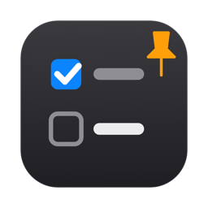
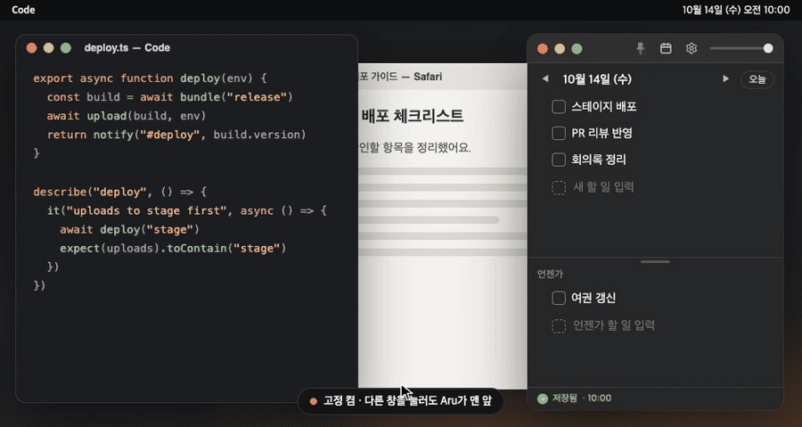
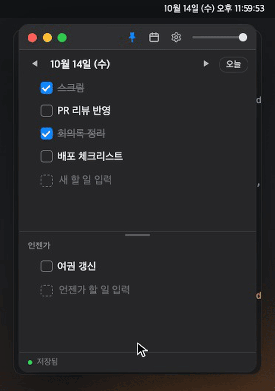
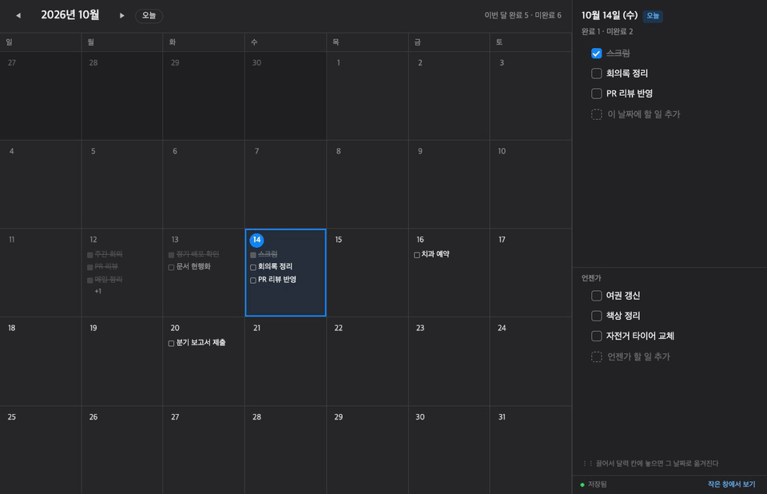
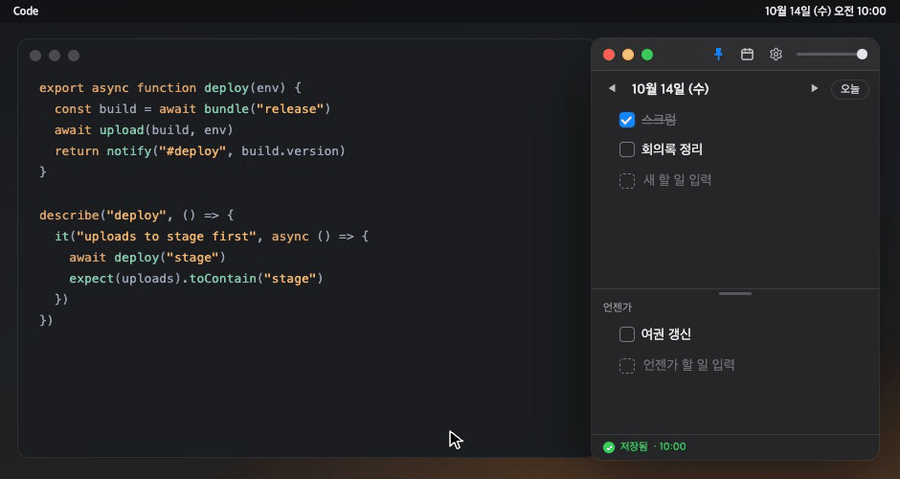
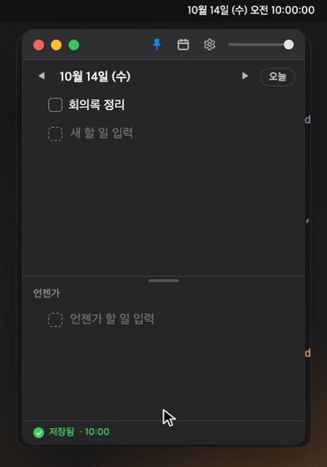

<div align="center">



# Aru

**모든 창 위에, 가리지 않게.**

하루 종일 작업 창 위에 떠 있는 작은 할 일 창.<br>
핀으로 늘 위에 두고 투명도로 뒤를 비춰 보고, 끝내지 못한 일은 자정에 다음 날로.

[**App Store에서 받기**](https://apps.apple.com/app/id6826470064) · [소개 페이지](https://aruu.dev/aru/)

<sub>Mac App Store ₩4,400 1회 결제 · 구독·광고 없음 · Apple Silicon·Intel 맥 · 서버도 계정도 없음 · Windows 출시 예정</sub>

<br>



</div>

<br>

## 늘 위에, 그러나 가볍게

핀이 켜져 있으면 편집기를 누르든 브라우저를 누르든 Aru가 그 위에 떠 있다. 핀을 끄면 보통 창처럼 뒤로 간다. 슬라이더로 창을 흐리게 하면 뒤의 작업이 비쳐 보이고, 끝까지 내려도 희미하게 남아 창을 잃어버리지 않는다.

## 끝내지 못한 일은, 다음 날로

자정이 지나면 위쪽이 새 날짜로 바뀐다. 끝내지 못한 일은 기본으로 다음 날로 넘어오고, 설정에서 바꿀 수 있다. 며칠 동안 맥을 꺼 두었어도 다음에 켤 때 한 번에 정리한다.

| 그대로 남기기 | 다음 날로 옮기기 (기본) | 언젠가로 옮기기 |
|:---:|:---:|:---:|
|  |  |  |
| 새 날은 빈 칸으로 시작 | "넘어옴" 표시를 달고 새 날로 | 언젠가 목록 끝으로 |

## AI는 넣기만, 지우지는 못한다

Claude Code, Codex 같은 AI 도구와 대화하다가 "할 일에 넣어줘"라고 하면 Aru에 바로 들어간다. 하루 대부분을 보내는 곳에서 할 일이 생기니 흐름이 끊기지 않는다.

- **추가·조회만** — AI가 할 수 있는 건 이 둘뿐이다. 지우기·고치기·체크는 못 한다.
- **`AI` 태그** — AI가 넣은 할 일에는 태그가 붙고, 태그를 누르거나 손대면 일반 할 일이 된다.
- **한 번에 되돌리기** — 방금 한꺼번에 들어온 할 일은 창 아래에서 한 번에 되돌린다. 그 할 일 밑에 직접 단 하위 줄(메모)이 있으면 할 일과 메모는 남기고 `AI` 태그만 뗀다.
- **끄기** — 설정에서 언제든 끌 수 있다. AI는 사용자가 직접 부탁할 때만 넣도록 안내받는다.

연결은 설정의 「AI 도구에 연결」에서 한다. Claude Code·Codex 버튼은 아래 등록 명령을 복사해 주니 터미널에 붙여넣어 실행하면 된다(이미 열려 있던 Claude Code·Codex는 다시 시작해야 보인다). 복사가 안 되면 명령이 화면에 나오니 직접 골라 복사한다. Claude 데스크톱 버튼은 확장 설치 창을 띄우니 Claude에서 설치를 확인한다. 직접 하려면:

```sh
# Claude Code
claude mcp add --scope user aru -- /Applications/Aru.app/Contents/MacOS/aru mcp
# Codex
codex mcp add aru -- /Applications/Aru.app/Contents/MacOS/aru mcp
# 터미널 명령으로 쓰기
ln -s /Applications/Aru.app/Contents/MacOS/aru /usr/local/bin/aru
aru add "PR 리뷰" "배포 체크"      # 오늘 맨 위에
aru add --someday "여권 갱신"
aru list
```

Claude 데스크톱은 설정의 개발자 탭에서 `claude_desktop_config.json`에 아래를 넣는다.

```json
{ "mcpServers": { "aru": { "command": "/Applications/Aru.app/Contents/MacOS/aru", "args": ["mcp"] } } }
```

## 할 일은 내 맥의 텍스트 파일로

적는 대로 알아서 저장하고, 날짜마다 마크다운 파일 하나로 남긴다. Obsidian이나 메모장으로 열어도 그대로 읽힌다. 저장 폴더를 Dropbox나 iCloud Drive로 바꾸면 다른 맥과 함께 쓸 수 있다. 빈 폴더를 고르면 지금까지의 할 일을 복사해 가고, 이미 할 일이 있는 폴더를 고르면 그 폴더의 할 일을 쓰며 옮기지 않았다고 창 아래에 잠깐 알린다(이전 폴더의 할 일은 그대로 남는다). 지금 폴더를 열 수 없는 상태에서 다른 폴더를 고르면 옮길 할 일을 읽지 못했다고 알린다. 쓸 수 없는 폴더(권한 없음, 읽기 전용 디스크 등)를 고르면 아무것도 바꾸지 않고 그 이유를 알린다. 고른 폴더를 열 수 없게 되면(옮겼거나 아직 연결되지 않았으면) 다른 곳에 몰래 저장하지 않고 창 아래에 알린다. 폴더가 돌아오면 그사이 적은 것을 합쳐 저장한다. 다른 편집기에서 적은 제목·메모와 줄바꿈 형식(CRLF)은 그대로 두고(다른 편집기가 줄바꿈 형식만 바꿔 저장해도 할 일이 둘이 되지 않는다), AI나 `aru` 명령이 Aru와 같은 파일에 동시에 써도 서로 덮어쓰지 않고 합친다.

```
저장 폴더/
├── daily/
│   ├── 2026-10-13.md
│   └── 2026-10-14.md
├── someday.md
└── settings.json
```

```markdown
- [x] 메일 확인
- [ ] 디자인 리뷰 준비
- [ ] 회의록 정리 <!-- from:2026-10-13 -->
```

<br>

## 한 달을 한눈에

달력 버튼을 누르면 큰 창에 월 달력이 열린다. 날짜를 누르면 오른쪽에서 바로 고치고, 언젠가 할 일을 달력 칸에 끌어 놓으면 그 날짜로 옮겨진다.

<div align="center"></div>

## ⌥ Space — 어떤 앱에서든 빠르게

다른 앱을 쓰다가 할 일이 떠오르면 `⌥ Space`. 지금 보고 있는 화면에 입력창이 뜨고, Enter를 누르면 오늘 할 일에 들어간 뒤 하던 앱으로 돌아간다. `Tab`을 누르면 언젠가 목록에 넣는다.

<div align="center"></div>

## 지난 날과 다가올 날

화살표로 하루씩 오가며 지난 기록을 보고, 앞으로의 날짜에 할 일을 미리 적어 둔다. 미리 적어 둔 일은 그날이 되면 오늘 목록에 나타난다.

<div align="center"></div>

## 할 일은 가볍게 적고 체크

위쪽에는 오늘 할 일, 아래쪽에는 날짜와 상관없는 언젠가 할 일. 적고 Enter를 누르면 추가되고, 체크박스를 누르거나 `⌘ Enter`를 누르면 끝낸 일이 된다. 방향키로 오늘과 언젠가 사이를 오갈 수 있다.

## 설치

[App Store](https://apps.apple.com/app/id6826470064)에서 받는다. 업데이트도 App Store가 맡는다.

결정: 직접 내려받는 0.2.8은 App Store판과 함께 내지 않고, 그 데이터(`~/Library/Application Support/dev.aruu.aru`)도 App Store판 샌드박스 컨테이너로 옮기지 않는다(`container-migration.plist` 없음).

**0.2.8을 쓰던 사람:** App Store판은 빈 목록으로 뜬다. 설정 → 폴더 변경에서 `~/Library/Application Support/dev.aruu.aru`를 고르면 이미 할 일이 있는 폴더라 그 할 일을 그대로 쓴다(Finder 대화상자에서 ⌘⇧G로 경로를 넣는다).

## 직접 빌드

[Node.js](https://nodejs.org) 20.19 이상과 [Rust](https://rustup.rs)가 필요하다.

```sh
npm install
npm run tauri dev      # 개발 모드로 실행
npm run tauri build    # src-tauri/target/release/bundle 에 Aru.app 생성
```

```sh
npm test               # 단위 테스트
npm run e2e            # 화면 시나리오 테스트 (Chrome)
npm run e2e:webkit     # 같은 시나리오를 WebKit으로
```

<sub>Tauri 2 · Vue 3 · TypeScript</sub>

## 의견 보내기

버그나 있었으면 하는 기능은 앱 **설정 → 의견 보내기**, 또는 [로그인 없는 폼](https://tally.so/r/laDqkN)으로 알려 주세요. GitHub 계정이 있다면 [이슈](https://github.com/CEO-Nick/Aru/issues/new/choose)도 좋아요.

## 라이선스

코드는 [MIT](LICENSE)로 자유롭게 쓸 수 있다. 단, "Aru"라는 이름과 아이콘은 라이선스에 포함되지 않는다. 코드를 가져가 따로 배포할 때는 다른 이름과 아이콘을 써 줘.
