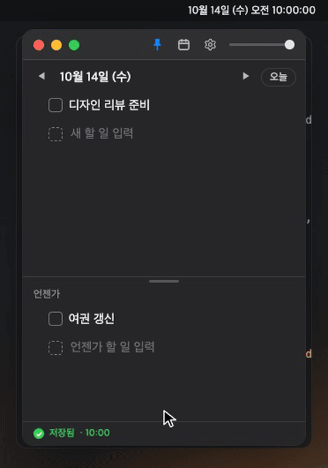
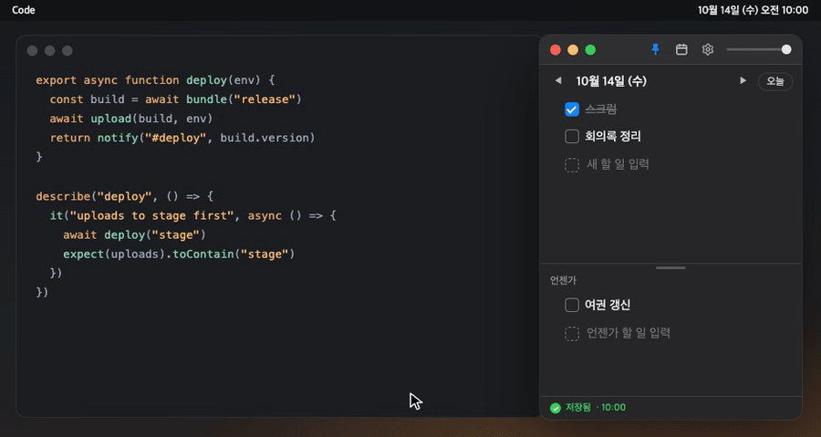
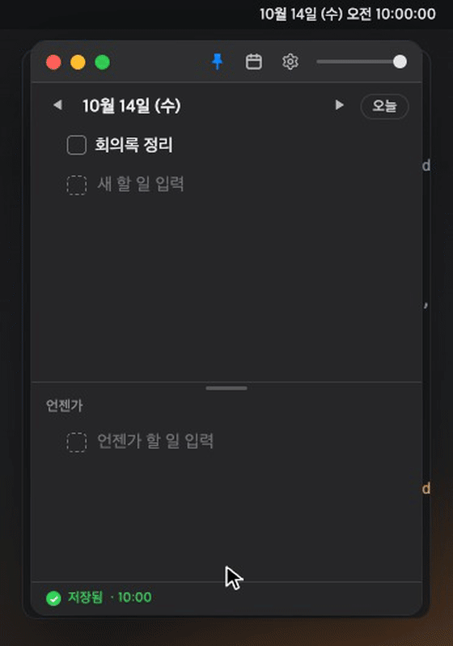
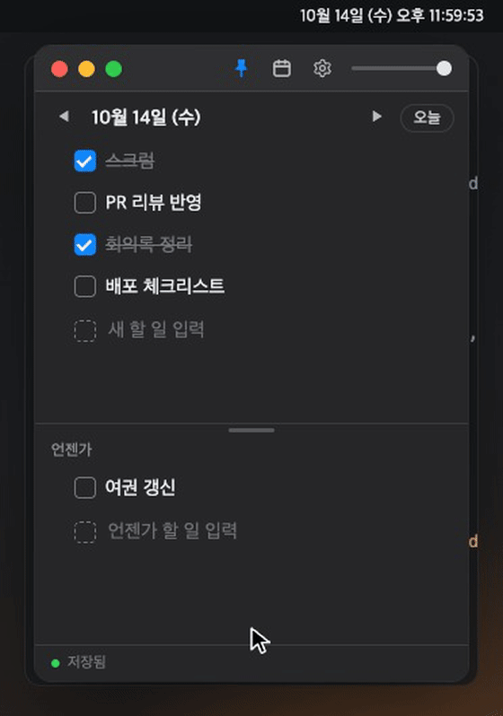
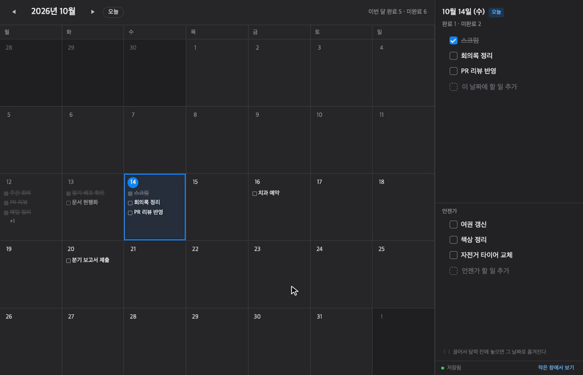
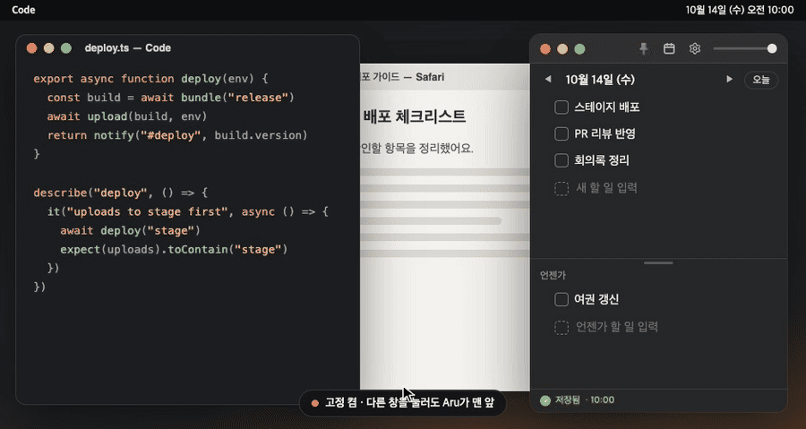

<div align="center">


# Aru

**모든 창 위에, 오늘 할 일.**

맥 화면 맨 위에 떠 있는 작은 할 일 창.<br>
오늘 할 일과 언젠가 할 일을 한 창에 두고, 무슨 일을 하든 시야에서 놓치지 않게.

[**macOS용 다운로드**](https://github.com/CEO-Nick/Aru/releases/latest/download/Aru-mac.zip) · [소개 페이지](https://aruu.dev/aru/)

<sub>무료 · Apple Silicon 맥 · 자동 업데이트 · 서버도 계정도 없음</sub>

<br>



</div>

<br>

## 할 일 추가

위쪽에는 오늘 할 일, 아래쪽에는 날짜와 상관없는 언젠가 할 일. 적고 Enter를 누르면 추가되고, 체크박스를 누르면 끝낸 일이 된다.

## ⌥ Space — 어떤 앱에서든 빠르게

다른 앱을 쓰다가 할 일이 떠오르면 `⌥ Space`. 지금 보고 있는 화면에 입력창이 뜨고, Enter를 누르면 오늘 할 일에 들어간 뒤 하던 앱으로 돌아간다. `Tab`을 누르면 언젠가 목록에 넣는다.

<div align="center"></div>

## 지난 날과 다가올 날

화살표로 하루씩 오가며 지난 기록을 보고, 앞으로의 날짜에 할 일을 미리 적어 둔다. 미리 적어 둔 일은 그날이 되면 오늘 목록에 나타난다.

<div align="center"></div>

## 자정이 지나면, 남은 일은 설정대로

자정이 지나면 위쪽이 새 날짜로 바뀐다. 끝내지 못한 일을 어떻게 할지 설정에서 고른다. 며칠 동안 맥을 꺼 두었어도 다음에 켤 때 한 번에 정리한다.

| 그대로 남기기 | 다음 날로 옮기기 | 언젠가로 옮기기 |
|:---:|:---:|:---:|
|  |  |  |
| 새 날은 빈 칸으로 시작 | "넘어옴" 표시를 달고 새 날로 | 언젠가 목록 끝으로 |

## 한 달을 한눈에

달력 버튼을 누르면 큰 창에 월 달력이 열린다. 날짜를 누르면 오른쪽에서 바로 고치고, 언젠가 할 일을 달력 칸에 끌어 놓으면 그 날짜로 옮겨진다.

<div align="center"></div>

## 늘 위에, 그러나 가볍게

핀이 켜져 있으면 어떤 창을 열어도 Aru가 맨 위에 떠 있다. 슬라이더로 창을 흐리게 하면 뒤의 작업이 비쳐 보이고, 끝까지 내려도 희미하게 남아 창을 잃어버리지 않는다.

<div align="center"></div>

## 할 일은 내 맥의 텍스트 파일로

적는 대로 알아서 저장하고, 날짜마다 마크다운 파일 하나로 남긴다. Obsidian이나 메모장으로 열어도 그대로 읽힌다. 저장 폴더를 Dropbox나 iCloud Drive로 바꾸면 다른 맥과 함께 쓸 수 있다.

```
저장 폴더/
├── daily/
│   ├── 2026-10-13.md
│   └── 2026-10-14.md
├── someday.md
└── settings.json
```

```markdown
- [x] 메일 확인
- [ ] 디자인 리뷰 준비
- [ ] 회의록 정리 <!-- from:2026-10-13 -->
```

<br>

## 설치

1. [Aru-mac.zip](https://github.com/CEO-Nick/Aru/releases/latest/download/Aru-mac.zip)을 내려받아 압축을 푼다.
2. `Aru.app`을 응용 프로그램 폴더로 옮긴다.
3. 처음 한 번만 **우클릭 → 열기**. Apple 인증서가 없는 개인 앱이라 처음 열 때만 확인 창이 뜬다.

## 직접 빌드

[Node.js](https://nodejs.org) 20.19 이상과 [Rust](https://rustup.rs)가 필요하다.

```sh
npm install
npm run tauri dev      # 개발 모드로 실행
npm run tauri build    # src-tauri/target/release/bundle 에 Aru.app 생성
```

```sh
npm test               # 단위 테스트
npm run e2e            # 화면 시나리오 테스트 (Chrome)
npm run e2e:webkit     # 같은 시나리오를 WebKit으로
```

<sub>Tauri 2 · Vue 3 · TypeScript</sub>

## 라이선스

코드는 [MIT](LICENSE)로 자유롭게 쓸 수 있다. 단, "Aru"라는 이름과 아이콘은 라이선스에 포함되지 않는다. 코드를 가져가 따로 배포할 때는 다른 이름과 아이콘을 써 줘.
